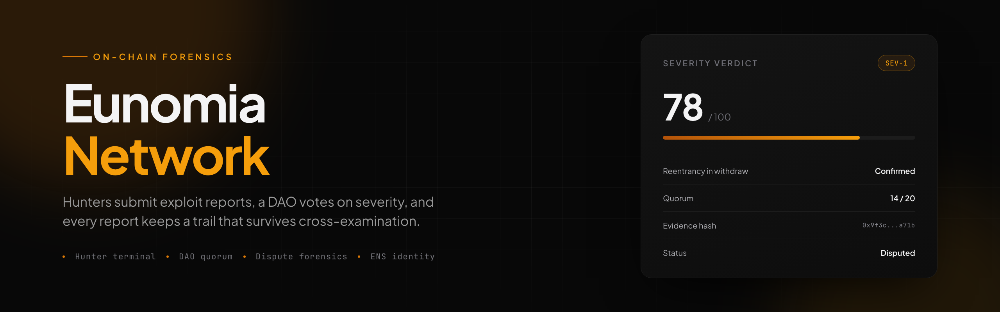
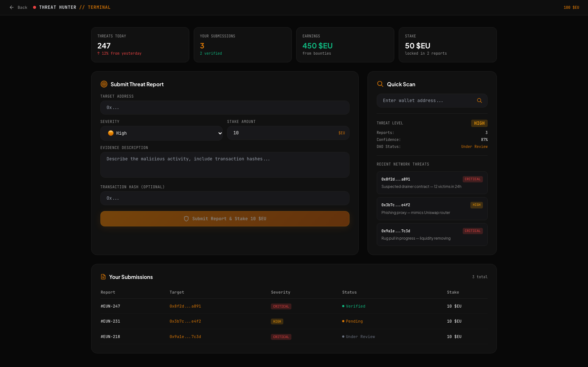
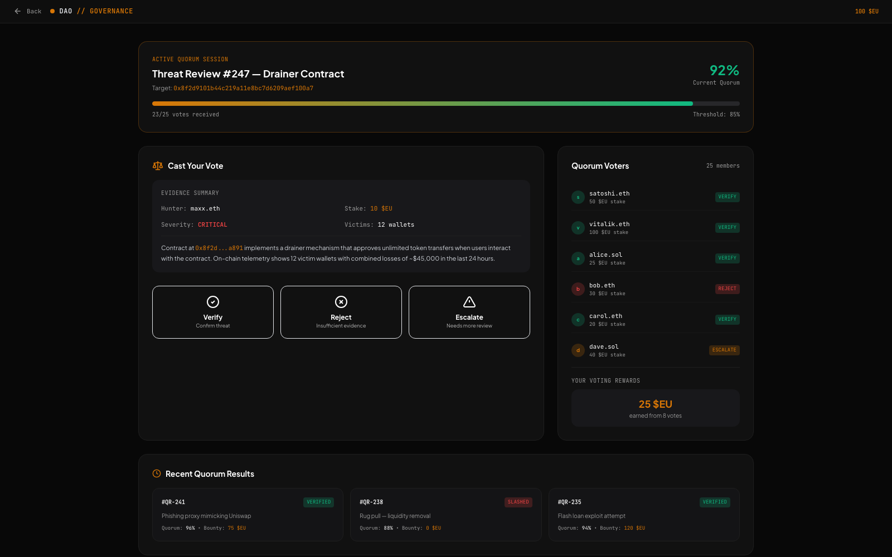
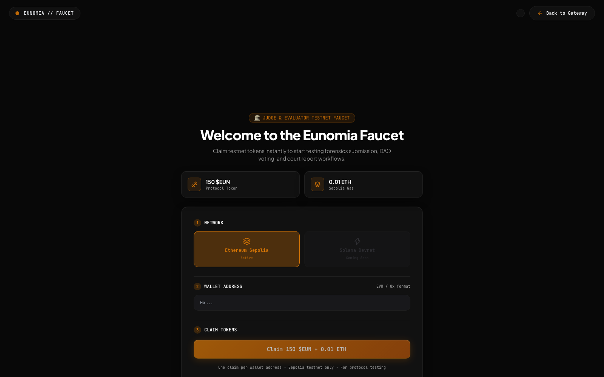
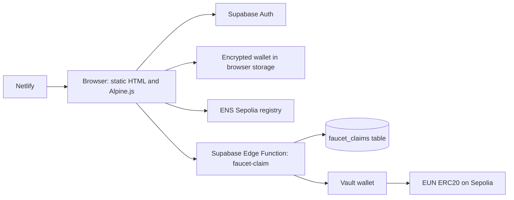

<p align="center">
  
</p>

<p align="center">
  <a href="https://github.com/maxxexee/eunomia-network/actions/workflows/check.yml"></a>
  <a href="LICENSE"></a>
  <a href="https://eunomia-protocol.netlify.app"></a>
  <a href="https://supabase.com"></a>
  <a href="ens.html"></a>
  <a href="faucet.html"></a>
</p>

Eunomia Network is an on-chain forensics product with a threat registry. A hunter submits an exploit report with a stake, a DAO votes on severity and quorum, and a dispute workspace keeps the evidence readable enough to survive cross-examination. Every report, court-ready.

> **Prototype.** Sign-in, wallet provisioning, ENS registration on Sepolia, and the faucet are wired to live services. The hunter, DAO, and dispute workspaces render built-in sample data and do not read from a registry table yet. Nothing here is audited.

## Contents

- [Why this exists](#why-this-exists)
- [What it does](#what-it-does)
- [Live demo](#live-demo)
- [Screens](#screens)
- [The workspaces](#the-workspaces)
- [How it works](#how-it-works)
- [Architecture](#architecture)
- [Auth and wallets](#auth-and-wallets)
- [ENS identity](#ens-identity)
- [Faucet](#faucet)
- [Verification](#verification)
- [Tech stack](#tech-stack)
- [Repository layout](#repository-layout)
- [Quickstart](#quickstart)
- [Environment variables](#environment-variables)
- [Scripts](#scripts)
- [Deploy](#deploy)
- [Known gaps](#known-gaps)
- [Roadmap](#roadmap)
- [Security](#security)
- [Contributing](#contributing)
- [License](#license)

## Why this exists

A threat report is only useful if someone can act on it later. Most channels lose the trail: a message in a group chat, a screenshot, a claim with no stake behind it. By the time the finding matters, nobody can show who reported it, what they staked, or how the decision was reached.

Eunomia keeps that trail. A hunter stakes tokens to submit, the DAO votes on severity with a quorum threshold, and the dispute workspace lays out the target, the evidence, and the verdict history in one place.

## What it does

- Signs a user in with Supabase, then provisions an EVM wallet in the browser with no extension.
- Encrypts the wallet key with PBKDF2-SHA256 and AES-GCM before it is stored.
- Registers an investigator identity as an ENS name on Sepolia.
- Runs a testnet faucet so a reviewer can try the flows without hunting for Sepolia ETH.
- Provides three workspaces for reporting, voting, and disputing, plus the identity and gateway pages that connect them.

## Live demo

https://eunomia-protocol.netlify.app

The frontend is a static site on Netlify. There is no build step and no server of its own. The only backend is one Supabase edge function for the faucet.

## Screens

| Hunter terminal | DAO governance |
| --- | --- |
|  |  |

| Faucet | |
| --- | --- |
|  | Open `faucet.html` to claim 150 EUN and Sepolia gas in one step. |

The screenshots were captured from the local site on port 8123 at 1600 by 1000.

## The workspaces

| Page | Workspace | What it does |
| --- | --- | --- |
| `index.html` | Landing | What the registry is, the severity gauge, and the API pitch |
| `onboard.html` | Operational gateway | After sign-in: provision a wallet, register a name, pick a workspace |
| `hunter.html` | Threat hunter terminal | Submit a report with a stake, run a quick scan on an address |
| `dao.html` | DAO governance quorum | Review threads, severity votes, quorum tracking, rewards |
| `dispute.html` | Dispute and legal forensics | Case-level analysis of a flagged contract |
| `ens.html` | Identity | Register an investigator name, one year term |
| `faucet.html` | Testnet faucet | One claim per address: 150 EUN plus Sepolia gas |

## How it works

1. A user signs in through Supabase with Google OAuth or an email magic link.
2. On first sign-in the app generates an EVM wallet and encrypts the key in the browser.
3. The user registers an ENS name on Sepolia so reports carry a readable author.
4. The faucet edge function sends test tokens once per address.
5. The workspaces render their sample report set so the flows can be reviewed before the registry table exists.

## Architecture



The browser holds the wallet key, encrypted. The service role key lives only in the edge function environment. Netlify serves the static files with an SPA fallback.

## Auth and wallets

Sign-in is Supabase: Google OAuth or an email magic link. On first sign-in the app generates an EVM wallet in the browser, then encrypts the key with PBKDF2-SHA256 at 100k iterations and AES-GCM 256 through Web Crypto. The unencrypted key never leaves the machine.

Wallet encryption depends on Web Crypto, so the site needs a browser that supports it and a secure context or localhost.

## ENS identity

Registration is real, not a mock. The page calls `register(...)` against the ENS Sepolia registry at `0x253553366Da8546Fc250F225fe3d12a07401295B` with the public resolver and a one-year term.

## Faucet

[`supabase/functions/faucet-claim`](supabase/functions/faucet-claim/index.ts) is a Deno edge function using ethers v6. It validates the address, refuses a second claim for the same address through the `faucet_claims` table, then sends an ERC20 transfer from the vault wallet. See [supabase/functions/README.md](supabase/functions/README.md).

## Verification

| Check | Surface | Result |
| --- | --- | --- |
| Repository checks | `node scripts/check-repo.mjs` | Required files, README links, image sizes, JS syntax |
| Auth | Google OAuth and email magic link | Live |
| Wallet provisioning | `js/config`, `js/wallet.js` | Generated and encrypted in the browser |
| ENS registration | `js/ens.js` on Sepolia | Live, one year term |
| Faucet claim | `faucet-claim` edge function | One claim per address |
| Hunter, DAO, dispute | Built-in report set | Sample data, not a running backend |
| Security review | None | Not audited |

Run the checks:

```bash
node scripts/check-repo.mjs
```

## Tech stack

| Layer | Technology |
| --- | --- |
| Pages | Static HTML, Alpine.js, Tailwind via CDN |
| Motion | GSAP, three.js |
| Auth and data | Supabase Auth, Postgres, Edge Functions |
| Chain | ethers, ENS Sepolia registry, Sepolia testnet |
| Host | Netlify |
| CI | GitHub Actions |

## Repository layout

```text
.
├── index.html            Landing page and severity gauge
├── onboard.html          Gateway after sign-in
├── hunter.html           Threat hunter terminal
├── dao.html              DAO governance quorum
├── dispute.html          Dispute and legal forensics
├── ens.html              Identity registration
├── faucet.html           Testnet faucet
├── css/styles.css        Shared styles
├── js/                   Auth, wallet, ENS, animation, page modules
├── supabase/functions/   faucet-claim edge function
├── docs/
│   ├── assets/           Banner, social preview, screenshots
│   └── brand.html        Source artboards for the image assets
├── scripts/              Repository checks
├── .github/              Issue forms, PR template, CI, Dependabot
└── netlify.toml          Static host config and SPA fallback
```

## Quickstart

Requirements: Python 3 or any static file server. Node.js 20 or newer for the repository checks.

```bash
git clone https://github.com/maxxexee/eunomia-network.git
cd eunomia
python3 -m http.server 8080
```

Open `http://localhost:8080`.

There is no build step. The pages load Alpine.js, ethers, Supabase, three.js, and GSAP from CDNs, so an offline machine renders the layout but not the live flows.

## Environment variables

The frontend Supabase URL and anon key live in `js/auth.js` and are public by design. The edge function needs these secrets, set in the Supabase project:

| Variable | Required | Description |
| --- | --- | --- |
| `SUPABASE_URL` | For the faucet | Supabase project URL |
| `SUPABASE_SERVICE_ROLE_KEY` | For the faucet | Service role key, never used in the browser |
| `SEPOLIA_RPC_URL` | For the faucet | Sepolia JSON-RPC endpoint |
| `VAULT_PRIVATE_KEY` | For the faucet | Vault wallet key that sends the claim |
| `EUN_CONTRACT_ADDRESS` | For the faucet | EUN ERC20 contract on Sepolia |

See [.env.example](.env.example) for the same list.

## Scripts

| Command | Description |
| --- | --- |
| `python3 -m http.server 8080` | Serve the site locally |
| `node scripts/check-repo.mjs` | Run repository checks |

## Deploy

- **Frontend:** Netlify publishes the repository root with an SPA fallback, configured in [netlify.toml](netlify.toml).
- **Functions:** [.github/workflows/deploy-functions.yml](.github/workflows/deploy-functions.yml) deploys `faucet-claim` to Supabase on any push to `main` that touches `supabase/functions/**`.
- **Checks:** [.github/workflows/check.yml](.github/workflows/check.yml) runs the repository checks on every push to `main` and every pull request.

## Known gaps

- The hunter, DAO, and dispute workspaces render built-in sample data. There is no registry table and no write path yet.
- The faucet function and the wallet encryption have not been reviewed by a third party.
- The edge function has no automated test. A claim can only be exercised against a real Supabase project.
- The pages depend on CDN builds of Alpine.js, ethers, Supabase, three.js, and GSAP with no integrity pins.
- The ENS flow is Sepolia only. No mainnet registration path exists.
- The severity score in the DAO workspace is a display of sample data, not a computed model.

## Roadmap

- Add the registry table and the write path for reports, votes, and disputes.
- Move the hunter, DAO, and dispute workspaces from sample data to the registry.
- Pin the CDN dependencies and add subresource integrity.
- Add a test for the faucet function against a throwaway Supabase project.
- Publish a short security review of the wallet encryption flow.

## Security

This is a prototype. Do not send real funds to the faucet vault, do not reuse a wallet key you care about, and do not treat a displayed verdict as a legal record.

The service role key belongs in the Supabase function environment only. The anon key in the browser is public by design.

Report vulnerabilities privately using the process in [SECURITY.md](SECURITY.md). Do not open a public issue for a security problem.

## Contributing

Read [CONTRIBUTING.md](CONTRIBUTING.md) before opening a pull request. Run:

```bash
node scripts/check-repo.mjs
```

Keep the README and docs free of emojis and em dashes.

## License

MIT License. See [LICENSE](LICENSE).
